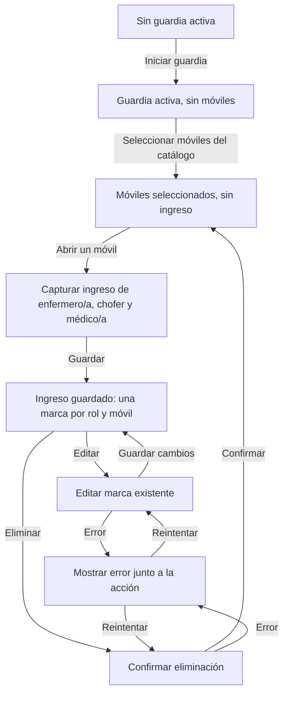

# Flujo de ingreso de móviles EFA

El flujo registra una sola hora de ingreso por rol y móvil seleccionado durante una guardia activa. Usa el catálogo de móviles existente y conserva sin cambios la dotación a nivel guardia.

## Recorrido

## Estados de la interfaz

| Estado                            | Presentación y acción disponible                                                                                    |
| --------------------------------- | ------------------------------------------------------------------------------------------------------------------- |
| Sin guardia                       | Acción para iniciar una guardia.                                                                                    |
| Guardia activa sin móviles        | Selección de uno o más móviles del catálogo existente.                                                              |
| Móviles seleccionados sin ingreso | Cada móvil puede abrirse para registrar una hora de ingreso por enfermero/a, chofer y médico/a.                     |
| Capturando                        | Se carga o corrige la hora de ingreso del rol elegido para ese móvil. La guardia conserva su dotación propia.       |
| Ingreso guardado                  | Se muestra la marca horaria con las acciones Editar y Eliminar. No se crean eventos de salida ni de movimiento.     |
| Confirmación o error              | Eliminar requiere confirmación. Los errores de edición o eliminación se muestran junto a la acción correspondiente. |

## Reglas del registro

- La clave funcional de la marca es guardia, móvil y rol.
- Cada combinación admite una sola marca de ingreso; editar modifica esa marca existente.
- Los roles son enfermero/a, chofer y médico/a.
- Los móviles provienen del catálogo existente. Este flujo no crea ni modifica móviles.
- La dotación de enfermería y choferes registrada en la guardia no se reemplaza ni se deriva de las marcas por móvil.
- El alcance actual termina en el ingreso: no se registran salida, ubicación ni movimientos.
